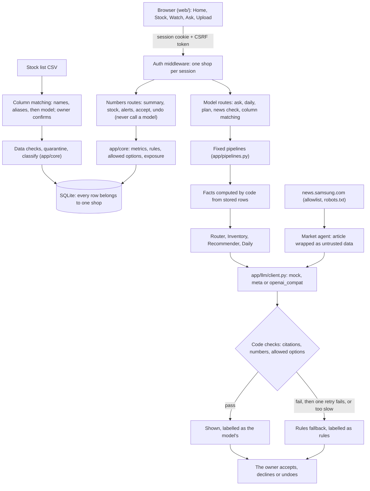

# Loreg

**A smart log and register for small electronics and appliance shops.**

## Core idea

A small shop owner often has money tied up in stock that has stopped selling, and every new product launch makes that stock harder to move. Loreg watches the shop's inventory, sales and market news, and tells the owner which shelf stock is at risk **before the loss grows**, so they can decide what to do with it.

("Stock" always means shelf inventory, never securities. Loreg gives no investment advice.)

## What Loreg does

- **Finds dead and slow stock** from inventory and sales data, and shows how much money is tied up.
- **Loreg Watch:** monitors manufacturer and market news for launches that put current stock at risk.
- **Loreg Daily:** a short morning summary.
- **Ask Loreg:** a chat for questions about the shop's stock.
- **One recommended action per at-risk item** (discount, bundle, return or hold). The owner accepts or declines.

## Principles

- **Alert first, then offer help.** A discount is never the first thing shown.
- **The owner makes the final call.** Recommendations are options with reasons.
- **Everything is cited.** Each alert or recommendation names the SKUs, metrics and dated sources it used, or says "not enough data".
- **Numbers come from code, not the model.** Dead-stock math is deterministic Python; the language model only explains and recommends from numbers the code computed.
- **Web content is untrusted data.** Instructions found in fetched articles are never followed.

## Scope

TVs, washing machines, washer-dryers, refrigerators, phones and laptops, for US shops.

## Hackathon

Built solo for the Meta Global AI Developer Hackathon (indie developer track, "Build for Your World").

## Prior work vs built during the hackathon

Hackathon work starts at the git tag **`hackathon-start`**. Everything in the commit with that tag is prior work, made before the event. Everything after it was built during the hackathon.

**Prior work** (all under [`prior/`](prior/), untouched since the tag; `prior/MANIFEST.sha256` lists a SHA-256 for every file):
- [`prior/dataset_v2/`](prior/dataset_v2/): the earlier synthetic dataset generator (`generate_dataset_v2.py`), its validator (`validate_dataset.py`), the classification and data-quality rules (`loreg_rules.py`), the price anchor table (`market_price_reference.csv`) and a 200-row demo upload.
- [`prior/web-prototype/`](prior/web-prototype/): a static frontend prototype (Bootstrap, five screens). It renders from a `snapshot.json` that `snapshot.py` computes from a product database CSV. It has no backend and no file upload. It was made before this repo existed.
- [`prior/docs/`](prior/docs/): the base context documents (`CONTEXT.md`, `LOREG_BASE_CONTEXT.md`).

**Built during the hackathon** (everything after `hackathon-start` is new work):
- The deterministic core, the API and storage, the model client, the agents, the 3,000-product catalog table and its generator, and the tests. Prior files are reference only; anything needed from them is reimplemented, not imported.
- [`web/`](web/) is the real frontend. Its markup, styles and layout are **derived from** `prior/web-prototype/`. All of its wiring is new work: API calls, real data, file upload, the alert-first flow, the streamed chat, and state that comes from the backend. The prototype's "purchase bill" screen is not built.

## Run it

From an empty folder, on the offline mock model (no key, no network needed for the app itself):

```
git clone https://github.com/vmndilip-star/Loreg.git
cd Loreg
python -m venv .venv
.venv\Scripts\activate                    # macOS / Linux: source .venv/bin/activate
pip install -r requirements-dev.txt         # exact versions, the ones the tests ran on
pip install --no-deps -e .
copy .env.example .env                    # macOS / Linux: cp .env.example .env
python -m uvicorn app.main:app
```

Then open http://127.0.0.1:8000/ and create an account (made-up details are fine: nothing is sent anywhere, and no email is checked). In `.env`, remove the `#` in front of `LOREG_DEMO=1` to get a "Use the demo stock list" button on the Upload screen (or choose the file `data/demo/upload_demo_200.csv`). Demo mode signs nobody in: every visitor signs in or creates an account first. `.env` is local and never committed; `.env.example` fixes the stock date at 2026-10-26 so the demo's numbers do not change with the calendar, and uses `LLM_BACKEND=mock`.

- **Real Meta model:** put `META_API_KEY` in `.env` and set `LLM_BACKEND=meta`. `python scripts/journey_meta.py` runs the whole demo journey once on it and saves a redacted transcript under `data/generated/`.
- **More synthetic data (optional):** `python data/generate_catalog.py` writes the 3,000-product database and the demo files under `data/generated/`.
- **Tests:** `python -m pytest -q`. They run offline on the mock model. `tests/test_journey.py` is the demo journey over the HTTP API; `tests/test_web_browser.py` repeats it in Chrome through Playwright and skips itself, with a message, if Playwright or Chrome is missing. `LOREG_DEMO=1 python -m pytest -q -k "browser or journey"` runs the journey tests with the demo switch already on.

- **Check the demo path:**
  - `python scripts/demo_smoke.py` runs the whole 3-minute demo headless and exits with an error on any failed check. Add `--backend meta` to run it on the real model.
  - `python scripts/reset_demo.py --yes` deletes the database and loads the demo shop, with the stock date fixed, for a known first-run state.
- **Measure:** `python scripts/run_evals.py` (21 hand-worked cases) and `python scripts/eval_fallback_rate.py` (how often answers fall back to the rules, and latency). The latest results are in [`docs/EVALS.md`](docs/EVALS.md).

The stock list may include an optional `map_price` column (minimum advertised price, in dollars; blank means none). See "Honest limits" for what the rule does and does not do.

A stock list with other column names (abbreviations like "Qty OH", or Hindi and Telugu written in Latin letters) is matched in three steps:
1. Code matches each header by its name, then by a list of aliases.
2. The model is asked only about the columns left over.
3. The owner confirms the matching before any row is stored.

The data checks then run as usual. `data/demo/upload_demo_200_messy.csv` is the demo file with such headers.

## How it is built

Custom code, with no agent framework (no LangChain, LangGraph, LlamaIndex, CrewAI, AutoGen, Semantic Kernel or an agents SDK). One file, `app/llm/client.py`, calls a model; each agent is one structured-output call whose answer code checks before it is used, with a deterministic fallback. The steps of every pipeline are fixed in code: the model never chooses the next step or a tool. [`docs/AGENT_FRAMEWORK_REPORT.md`](docs/AGENT_FRAMEWORK_REPORT.md) lists every agent, prompt, check, fallback and test, and the gaps.



**Why a deterministic core with grounded agents.** A shop owner acts on these numbers with real money, so they must be the same every time and checkable by hand (`tests/test_core.py` holds hand-worked values). Code computes every number and decides which actions are allowed. The model only explains them and picks among the allowed options. Each answer is checked against the facts it was given, so a wrong or slow model answer becomes a labelled rules answer, never a wrong number.

**Backends.** One switch, `LLM_BACKEND`, chooses the model: `mock` (the default; offline, no key), `meta` (needs `META_API_KEY`) or `openai_compat` (needs `OPENAI_COMPAT_BASE_URL` and `OPENAI_COMPAT_MODEL`). The page always shows which backend is answering. With `mock` it says "offline test writer, no model", so offline output never looks like model output.

Each shop has its own account. Every `/api` route needs a signed-in session, every POST carries a CSRF token, and every query that reads or writes one shop's rows filters by that shop (`tests/test_isolation.py` walks every route as a second shop). Fetched news is shared by all shops.

## Honest limits

- **One news source.** Loreg Watch reads only `news.samsung.com` (see `config/news_sources.yaml`). Other brands' feeds are not added until their `robots.txt` and terms have been read.
- **robots.txt times out.** The Samsung `robots.txt` often does not answer within the 10-second limit. A successful answer is cached for 24 hours; if it cannot be read and nothing is cached, the scan stops and does not fetch the feed. The Watch page then shows stored copies with their true dates, never as fresh.
- **The demo alert's article is synthetic.** None of the 50 real items read on 2026-10-28 announced a newer generation of a line in our catalog, so in demo mode the alert uses an article labelled "Demo article (synthetic)". Real items captured earlier are listed as "Stored copy". A real article only becomes an alert's source outside demo mode. The synthetic article also states a made-up launch date, 25 days after the stock list's date, so the demo has a date to work with; it is always called synthetic, and no real launch date is claimed anywhere.
- **The required pace is arithmetic, not a forecast.** When an alert's source states a launch date with a year, the alert shows how many units a day would have to sell to clear the exposed stock by then (units divided by days left, rounded up; computed by code from the app's clock). It says nothing about what will sell. On the day of the launch, and after it, no pace is shown.
- **The 30-day stale limit is our assumption.** News older than `watch.stale_after_days` (30, in `config/thresholds.yaml`) is flagged as not fresh. No source or rule gave that number.
- **The MAP rule is a conservative simplification.** The `map_price` column and the rule (a discount is offered only while the price stays at or above both cost and MAP) are our own design. Real minimum-advertised-price policies are more nuanced (per brand, per channel, bundles, promotions); Loreg never offers a discount that could break the simple rule, and says why when one is blocked.
- **The launch tracker only knows stored news.** It follows the launch date each tracked line's news states, word for word. A date that has come is "due", not launched; only a later article (published on or after that day, naming the line, saying "now available" or "on sale now" and nothing like "will be available" or a delay) confirms a launch, and only after "Check for news". With no such article it becomes "unverified" after a 7-day grace period (an assumption, in `config/thresholds.yaml`), which never means delayed. A date without a year, a month only, or several dates in one article never become due. Days are compared as calendar days in UTC, so near midnight a US store's local date can differ by one. The synthetic demo article has its own labelled entry that real news never dates or confirms.
- **The sales history is assumed long enough.** Loreg assumes the export's sales history covers at least the dead threshold (see `config/thresholds.yaml`) and does not verify it. An item with no recorded sale and a received date older than that threshold is called dead; if the export only covers a shorter period, that is wrong. An item that was never sold and has no received date is shown as "Not enough data" instead of being guessed (the demo has one).
- **`openai_compat` has not been tried against a real endpoint.** The backend for any OpenAI-compatible host exists and is tested only against fakes.
- **The open-weights run was skipped.** No open-weights partner key was available, so nothing was run on an open-weights model. Every real-model run so far used the Meta Model API.
- **The model's numbers are checked, its words are not.** Every number in a model's answer must appear in one of the facts code gave it, and every citation must be a real fact, or the deterministic answer is used instead. The check does not prove a number was used with the right fact, and it does not check claims made in words.
- **The model API's own tool calling is not used.** Every model call is one request for structured JSON; the "tool" steps in the chat stream are code steps, not tools the model chose. `scripts/api_check.py` holds a one-off tool-calling check for the Meta API, whose current result is not recorded; nothing in the app depends on tool calling.
- **Account existence can be inferred at signup.** Signing up with a registered email says so (409), so someone can learn that an email has an account. Sign-in gives one message for a wrong email or a wrong password.
- **No email verification and no password reset.** An account is created without checking that its email is real, and a forgotten password cannot be reset.
- **Rate limits live in memory.** Signup (5 per address per 15 minutes) and sign-in back-off reset when the app restarts, and are per app process. The address is the direct connection's: behind a proxy every visitor would share the proxy's address, and the session cookie is marked Secure only when the app itself sees https. No proxy headers are trusted.
- **Data from before accounts belongs to a shop no one can sign in to.** A database made before accounts keeps its rows under its first shop, which has no email and no password. Nothing signs in to it, demo mode included.
- **Accepting a plan is not selling.** Accepting moves an item's capital from "at risk" to "action in progress". It counts as freed only when the units sell, and Loreg cannot see sales after the upload. At risk plus action in progress always stays the same total.
- **The fallback rate is measured, not promised.** On 2026-10-30, 0 of 75 Meta calls over the demo workload fell back to the rules, and all 21 eval cases passed on Meta ([`docs/EVALS.md`](docs/EVALS.md)). That sample is small and was taken on one day. The app still falls back whenever an answer fails a check, and the badge under the header shows how often it has.
- **An eval pass is a safety check.** It shows the proposal stayed within the allowed options and passed the checks. It does not judge whether the option was the best one for the shop.
- **Column matching knows common spellings only.** The aliases (including Hindi and Telugu in Latin letters) are a fixed list. Anything else goes to the model, and its suggestions are marked "please check". The owner's confirmation is what counts. Data checks still run on every row, but a column confirmed under the wrong field can still give wrong numbers.
- **No point-of-sale integration.** Stock comes only from a CSV upload. Loreg does not see live sales.
- **No investment advice.** "Stock" always means shelf inventory, never securities.
- **Logs go to stderr only.** One JSON line per request and per agent call, with no prompts, answers or secrets. Nothing collects or keeps them.
- **Everything else is synthetic.** All stock data, prices and sales are generated; they show that the app works, not that any price is true.

## Live news (Loreg Watch)

News is read only from the hosts listed in `config/news_sources.yaml` (today: `news.samsung.com`), over https, with `robots.txt`, conditional GET, a size cap and hand-checked redirects. Only a short verbatim excerpt (280 characters or fewer), the title, address, dates and a content hash are kept; the article body is cleared once it has been read. An alert shows a source only if the article has a readable publication date, and it cites the address, the published date, the fetched date and the last check. If the feed cannot be reached the alert says "Stored copy" with its true dates. News is aged against today's date. The demo's stored copies in the repo hold only titles, addresses, dates and hashes, no article text; `python scripts/capture_demo_news.py` writes the excerpts to a git-ignored local file that stays on your machine.

In demo mode (`LOREG_DEMO=1`) every launch alert carries a labelled source: a stored copy of a real article if `data/demo/news_copy.json` exists, otherwise a synthetic article labelled "Demo article (synthetic)". `python scripts/capture_demo_news.py` reads the feed once (when `robots.txt` answers) and writes `data/demo/news_items.json`, the real items listed as "Stored copy" on the Watch page; with `--pick N` it also writes the alert's stored copy. In demo mode a news scan adds real items to the list but never replaces the demo alert.

## Status

These work end to end on synthetic data:
- **Backend:** deterministic core, upload and data checks, column matching, storage, Loreg Watch, agents, streamed chat with a non-streaming fallback, daily brief.
- **Web app:** Home, Stock with browse and search, Watch, Ask, Upload.
- **Accounts:** signup, sign-in, sign-out, sessions, CSRF, per-shop data.
- **Measurement:** the fallback rate and the eval set, on mock and on Meta.

The QuickBooks import and the open-weights run are not done. See "Honest limits".

**Not built (stretch list):**
- Shelf-photo counting, where the owner confirms counts before any number changes.
- Model-suggested matches between news articles and catalog lines. They would be shown only as suggestions; an alert's source still needs an exact name match.
- Point-of-sale or QuickBooks import.
- An open-weights run.
- Bill and invoice generation from the organization profile. Nothing in Loreg creates, sends or stores a bill or an invoice today.
