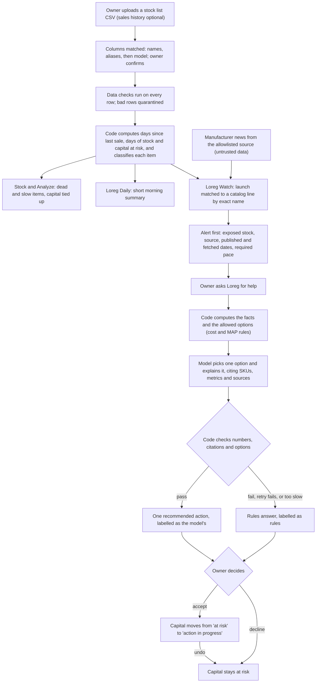
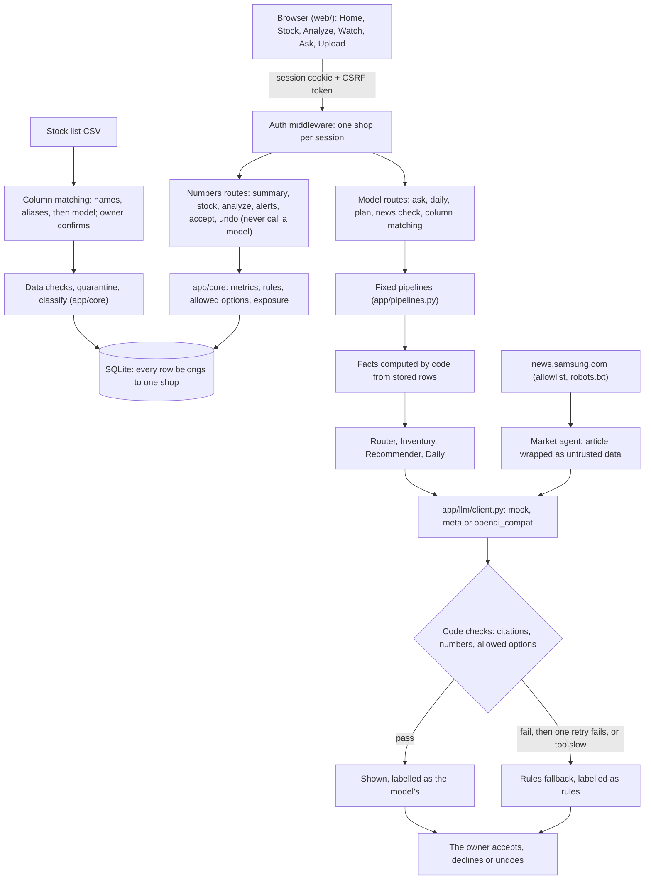

# Loreg

**A smart log and register for small electronics and appliance shops.**

Loreg (pronounced *LOW-reg*) tells a shop owner which shelf stock has stopped selling, how much money is tied up in it, and which product launches are about to make it harder to move, so the owner can act **before the loss grows**. Loreg alerts and explains. The owner decides.

Built solo for the **Meta Global AI Developer Hackathon** (indie developer track, "Build for Your World").

**Demo video:** [Loreg: AI that finds the money stuck on a small shop's shelves](https://youtu.be/Zq97p3Vrbzo)

> "Stock" in Loreg always means shelf inventory, never securities. Loreg gives no investment advice.

## The problem

A small shop owner often has money tied up in stock that has stopped selling, and every new product launch makes that stock harder to move. Loreg watches the shop's inventory, sales and market news, flags the stock at risk early, and shows the numbers and dated sources behind every flag.

**Scope:** TVs, washing machines, washer-dryers, refrigerators, phones and laptops, for US shops.

## What Loreg does

| Feature | What the owner gets |
|---|---|
| **Dead and slow stock** | Items that have stopped selling, found from stock and sales data, with the capital tied up in them. |
| **Loreg Watch** | Alerts when manufacturer news announces a launch that puts current stock at risk, citing the source and its dates. |
| **Loreg Daily** | A short morning summary. |
| **Ask Loreg** | A streamed chat for questions about the shop's stock. |
| **Analyze** | A category's figures, its sales history (the last day, 7, 30 and 365 days; by month and by year) and what to buy. |
| **One action per at-risk item** | Discount, bundle, return or hold, offered as an option with reasons. The owner accepts, declines or undoes it. |

## How it works

From a stock list to the owner's decision. Code computes every number, the model only explains and picks among options code allows, and the owner makes the call.



1. **Upload.** The owner uploads a stock list CSV, and optionally a sales history.
2. **Match columns.** Code matches headers by name, then by alias. The model suggests matches only for the columns left over, and the owner confirms before any row is stored.
3. **Check the data.** Every row is checked, and bad rows are quarantined.
4. **Compute.** Code computes each item's days since last sale, days of stock and capital at risk, and classifies it. An item it cannot judge shows "Not enough data". Stock and Analyze show the results, and Loreg Daily gives the short morning summary.
5. **Watch the market.** Loreg Watch reads the allowlisted news source, treats every article as untrusted data, and matches a launch to a catalog line by exact name.
6. **Alert first.** The owner sees the alert: the exposed stock, the source with its published and fetched dates, and the required pace when the launch date has a year. No discount is shown yet.
7. **Ask for help.** The owner asks Loreg, for example "What should I clear before the launch?" Code computes the facts and the allowed options; a discount is allowed only while the price stays at or above both cost and MAP. The model picks one option (discount, bundle, return or hold) and explains it, citing the SKUs, metrics and sources it used. Code checks every number and citation. An answer that fails, fails again on one retry, or is too slow becomes a labelled rules answer.
8. **Decide.** The owner accepts, declines or undoes. Accepting moves the item's capital from "at risk" to "action in progress"; it counts as freed only when the units sell.

## The 3-minute demo

[](https://youtu.be/Zq97p3Vrbzo)

[Watch the demo video on YouTube](https://youtu.be/Zq97p3Vrbzo). Its screens are a motion recreation of the Loreg app using its sample data, not a screen recording. To see the app itself, [launch the demo](#2-launch-the-demo-fastest-way-to-see-loreg) and follow these steps:

1. **Upload** the 200-SKU demo stock list. Data checks run, and dead and slow items appear with the capital tied up in them.
2. **Loreg Daily** gives the morning summary.
3. **Loreg Watch** shows a launch alert with its source, published date and fetched date. In demo mode this article is synthetic and labelled "Demo article (synthetic)" (see [Honest limits](#honest-limits)).
4. **Ask Loreg:** "What should I clear before the launch?"
5. **Accept** one recommended action. Its capital moves from "at risk" to "action in progress", and the totals update.

## Principles

- **Alert first, then offer help.** A discount is never the first thing shown.
- **The owner makes the final call.** Recommendations are options with reasons.
- **Everything is cited.** Each alert or recommendation names the SKUs, metrics and dated sources it used, or says "not enough data".
- **Numbers come from code, not the model.** Dead-stock math is deterministic Python. The model only explains and recommends from numbers the code computed.
- **Web content is untrusted data.** Instructions found in fetched articles are never followed.

## Launch Loreg

### 1. Install (once)

```bash
git clone https://github.com/vmndilip-star/Loreg.git
cd Loreg
python -m venv .venv
source .venv/bin/activate            # Windows: .venv\Scripts\activate
pip install -r requirements-dev.txt  # exact versions the tests ran on
pip install --no-deps -e .
cp .env.example .env                 # Windows: copy .env.example .env
```

`.env` is local and never committed. `.env.example` uses `LLM_BACKEND=mock`, the offline mock model (no key, and no network needed for the app itself), and fixes the stock date at 2026-10-26 so the demo's numbers do not change with the calendar.

### 2. Launch the demo (fastest way to see Loreg)

1. In `.env`, remove the `#` in front of `LOREG_DEMO=1`.
2. Reset the demo data:
   ```bash
   python scripts/reset_demo.py --yes
   ```
   This deletes the database and makes the demo account (organization **BigDeal**) with the demo stock list and a synthetic sales history made from it, with the stock date fixed, for a known first-run state.
3. Start the app:
   ```bash
   python -m uvicorn app.main:app
   ```
4. Open http://127.0.0.1:8000/ and sign in. "Use demo account" on the sign-in page fills these in:
   - email `demo@gmail.com`
   - password `Loreg@1234`
5. Follow [the 3-minute demo](#the-3-minute-demo).

Demo mode also adds a "Use the demo stock list" button to the Upload screen (or choose `data/demo/upload_demo_200.csv`), and Account → "Reset demo data", which puts the demo account back as the script left it (demo mode only, and for no other account). Demo mode signs nobody in: every visitor signs in or creates an account first.

> [!WARNING]
> **This is a public demo credential.** It is printed here and shown on the sign-in page, so it protects nothing. Never put real data in the demo account, and never run with `LOREG_DEMO=1` on a host other people can reach (`LOREG_ENV=production` refuses to start with it). `LOREG_DEMO_EMAIL` and `LOREG_DEMO_PASSWORD` change it. The password is shorter than the 12 characters signup asks for; only the seed script may make an account like that.

### 3. Launch with your own stock list

1. Leave `LOREG_DEMO=1` commented out in `.env`.
2. Start the app with `python -m uvicorn app.main:app` and open http://127.0.0.1:8000/.
3. Create an account. Made-up details are fine: nothing is sent anywhere, and no email is checked.
4. On the Upload screen, upload your stock list and confirm the column matching. Optionally upload a sales history. See [Using your own stock list](#using-your-own-stock-list).

### 4. Launch on the real Meta model

1. In `.env`, put your `META_API_KEY` and set `LLM_BACKEND=meta`.
2. Start the app as above. The page always shows which backend is answering.
3. Optional: `python scripts/journey_meta.py` runs the whole demo journey once on the real model and saves a redacted transcript under `data/generated/`.

For any OpenAI-compatible host, set `LLM_BACKEND=openai_compat` with `OPENAI_COMPAT_BASE_URL` and `OPENAI_COMPAT_MODEL` (tested only against fakes; see [Honest limits](#honest-limits)).

Stop the app with Ctrl+C.

### Before a live demo

1. `python scripts/reset_demo.py --yes` for a known first-run state.
2. `python scripts/demo_smoke.py` runs the whole 3-minute demo headless and exits with an error on any failed check. Add `--backend meta` if you are presenting on the real model.

### Running it where other people can reach it

Loreg is a hackathon build, not a hardened service: rate limits live in memory, there is no email verification and no password reset (see [Honest limits](#honest-limits)). If you run it anywhere other people can reach:

- Set `LOREG_ENV=production` and keep `LOREG_DEMO` off. Production refuses to start with demo mode on.
- Serve it over https. Behind a proxy that ends https, cookies need `LOREG_COOKIE_SECURE=1`, which is the default under `LOREG_ENV=production`.

## Test, check and measure

| Command | What it does |
|---|---|
| `python -m pytest -q` | All tests, offline on the mock model. |
| `LOREG_DEMO=1 python -m pytest -q -k "browser or journey"` | Only the journey tests, with the demo switch on. In PowerShell, run `$env:LOREG_DEMO="1"` first and drop the prefix. |
| `python scripts/demo_smoke.py` | Runs the whole 3-minute demo headless and exits with an error on any failed check. Add `--backend meta` for the real model. |
| `python scripts/run_evals.py` | 21 hand-worked eval cases. |
| `python scripts/eval_fallback_rate.py` | How often answers fall back to the rules, and latency. |
| `python data/generate_catalog.py` | Optional: writes the 3,000-product database and the demo files under `data/generated/`. |

Key test files: `tests/test_core.py` (hand-worked values for the core math), `tests/test_isolation.py` (walks every route as a second shop), `tests/test_journey.py` (the demo journey over the HTTP API) and `tests/test_web_browser.py` (the same journey in Chrome through Playwright; it skips itself, with a message, if Playwright or Chrome is missing). Latest results: [`docs/EVALS.md`](docs/EVALS.md).

## Using your own stock list

**Column matching.** A stock list with other column names (abbreviations like "Qty OH", or Hindi and Telugu written in Latin letters) is matched in three steps:

1. Code matches each header by its name, then by a list of aliases.
2. The model is asked only about the columns left over. Its suggestions are marked "please check".
3. The owner confirms the matching before any row is stored.

The data checks then run on every row as usual. `data/demo/upload_demo_200_messy.csv` is the demo file with such headers.

**Minimum advertised price.** An optional `map_price` column, in dollars (blank means none). A discount is offered only while the price stays at or above both cost and MAP. See [Honest limits](#honest-limits) for what this rule does and does not do.

**Sales history.** A separate CSV with the columns `sku`, `date`, `qty` and `unit_price` (`type` is optional), matched by those exact names. Without one, Analyze shows only the stock list's own 30- and 90-day totals and says so.

## How it is built

Custom code, with no third-party agent framework. One file, `app/llm/client.py`, calls a model. Each agent is one structured-output call whose answer code checks before it is used, with a deterministic fallback. The steps of every pipeline are fixed in code: the model never chooses the next step or a tool. [`docs/AGENT_FRAMEWORK_REPORT.md`](docs/AGENT_FRAMEWORK_REPORT.md) lists every agent, prompt, check, fallback and test, and the gaps.



**Why a deterministic core with grounded agents.** A shop owner acts on these numbers with real money, so they must be the same every time and checkable by hand (`tests/test_core.py` holds hand-worked values). Code computes every number and decides which actions are allowed. The model only explains them and picks among the allowed options. Each answer is checked against the facts it was given, so a wrong or slow model answer becomes a labelled rules answer, never a wrong number.

**Backends.** One switch, `LLM_BACKEND`, chooses the model: `mock` (the default; offline, no key), `meta` (needs `META_API_KEY`) or `openai_compat` (needs `OPENAI_COMPAT_BASE_URL` and `OPENAI_COMPAT_MODEL`). The page always shows which backend is answering. With `mock` it says "offline test writer, no model", so offline output never looks like model output.

**Accounts and isolation.** Each shop has its own account. Every `/api` route needs a signed-in session, every POST carries a CSRF token, and every query that reads or writes one shop's rows filters by that shop. Fetched news is shared by all shops.

## Loreg Watch: live news

News is read only from the hosts listed in `config/news_sources.yaml` (today: `news.samsung.com`), over https, with `robots.txt`, conditional GET, a size cap and hand-checked redirects. Only the title, address, dates, a content hash and a short verbatim excerpt (280 characters or fewer) are kept. The article body is cleared once it has been read.

An alert shows a source only if the article has a readable publication date, and it cites the address, the published date, the fetched date and the last check. If the feed cannot be reached, the alert says "Stored copy" with its true dates. News is aged against today's date.

**In demo mode** (`LOREG_DEMO=1`) every launch alert carries a labelled source: a stored copy of a real article if `data/demo/news_copy.json` exists, otherwise a synthetic article labelled "Demo article (synthetic)". A news scan adds real items to the list but never replaces the demo alert. The repo's stored copies hold only titles, addresses, dates and hashes, no article text.

`python scripts/capture_demo_news.py` reads the feed once (when `robots.txt` answers) and writes `data/demo/news_items.json`, the real items listed as "Stored copy" on the Watch page. With `--pick N` it also writes the alert's stored copy. It writes the excerpts to a git-ignored local file that stays on your machine.

## Status

These work end to end on synthetic data:

- **Backend:** deterministic core, upload and data checks, column matching, sales history upload, storage, Loreg Watch, agents, streamed chat with a non-streaming fallback, Loreg Daily.
- **Web app:** Home, Stock (browse and search), Analyze, Watch, Ask, Upload.
- **Accounts:** signup, sign-in, sign-out, sessions, CSRF, per-shop data.
- **Measurement:** the fallback rate and the eval set, on mock and on Meta.

Not done: the open-weights run (see [Honest limits](#honest-limits)).

## Honest limits

### Data

- **The demo video is a recreation.** Its screens are a motion recreation of the app using its sample data, not a screen recording, and its shop is a sample shop with synthetic data.
- **Everything is synthetic.** All stock data, prices and sales are generated. They show that the app works, not that any price is true.
- **The demo's sales history is synthetic.** `scripts/make_demo_sales.py` makes it from the demo stock list with a fixed seed: every item's sales in the last 30 and 90 days and its last sale date match the list. Before that, sales follow the item's 90-day pace, with more in November and December (an assumption). The page labels it "Synthetic sales history".
- **The sales history is assumed long enough.** Loreg assumes the export's sales history covers at least the dead threshold (see `config/thresholds.yaml`) and does not verify it. An item with no recorded sale and a received date older than that threshold is called dead; if the export only covers a shorter period, that is wrong. An item that was never sold and has no received date is shown as "Not enough data" instead of being guessed (the demo has one).
- **A sales history is matched exactly.** There is no column matching for it. It is read against the stock list's date: a sale dated after it is set aside. SKUs are matched exactly as written, so `tv-1` and `TV-1` are different items.
- **Column matching knows common spellings only.** The aliases (including Hindi and Telugu in Latin letters) are a fixed list. Anything else goes to the model, and its suggestions are marked "please check". The owner's confirmation is what counts. Data checks still run on every row, but a column confirmed under the wrong field can still give wrong numbers.
- **No point-of-sale integration.** Stock and sales history come only from CSV uploads. Loreg does not see live sales.

### Market news

- **One news source.** Loreg Watch reads only `news.samsung.com`. Other brands' feeds are not added until their `robots.txt` and terms have been read.
- **robots.txt often times out.** The Samsung `robots.txt` often does not answer within the 10-second limit. A successful answer is cached for 24 hours. If it cannot be read and nothing is cached, the scan stops and does not fetch the feed; the Watch page then shows stored copies with their true dates, never as fresh.
- **The demo alert's article is synthetic.** None of the 50 real items read on 2026-10-28 announced a newer generation of a line in our catalog, so in demo mode the alert uses an article labelled "Demo article (synthetic)". Real items captured earlier are listed as "Stored copy". A real article only becomes an alert's source outside demo mode. The synthetic article states a made-up launch date, 25 days after the stock list's date, so the demo has a date to work with. It is always called synthetic, and no real launch date is claimed anywhere.
- **The 30-day stale limit is our assumption.** News older than `watch.stale_after_days` (30, in `config/thresholds.yaml`) is flagged as not fresh. No source or rule gave that number.
- **The launch tracker only knows stored news.** It follows the launch date each tracked line's news states, word for word. A date that has come is "due", not launched. Only a later article confirms a launch: one published on or after that day, naming the line, saying "now available" or "on sale now" and nothing like "will be available" or a delay, and only after "Check for news". With no such article, the line becomes "unverified" after a 7-day grace period (an assumption, in `config/thresholds.yaml`), which never means delayed. A date without a year, a month only, or several dates in one article never become due. Days are compared as calendar days in UTC, so near midnight a US store's local date can differ by one. The synthetic demo article has its own labelled entry that real news never dates or confirms.

### Recommendations

- **The required pace is arithmetic, not a forecast.** When an alert's source states a launch date with a year, the alert shows how many units a day would have to sell to clear the exposed stock by then (units divided by days left, rounded up; computed by code from the app's clock). It says nothing about what will sell. On the day of the launch, and after it, no pace is shown.
- **"What to buy" is arithmetic, not a forecast.** It stocks each healthy item up to 45 days (`restock.target_days` in `config/thresholds.yaml`, our assumption) at its own pace over the last 90 days, in whole units rounded up, at what the shop paid per unit. It knows nothing about lead times, minimum orders, supplier prices, the season ahead or the shop's cash. It suggests waiting on new items and on lines Loreg's catalog marks as ones a newer line may replace, and buying no more of dead or slow stock.
- **The MAP rule is a conservative simplification.** The `map_price` column and the rule (a discount is offered only while the price stays at or above both cost and MAP) are our own design. Real minimum-advertised-price policies are more nuanced (per brand, per channel, bundles, promotions). Loreg never offers a discount that could break the simple rule, and says why when one is blocked.
- **Accepting a plan is not selling.** Accepting moves an item's capital from "at risk" to "action in progress". It counts as freed only when the units sell, and Loreg cannot see sales after the upload. At risk plus action in progress always stays the same total.
- **An eval pass is a safety check.** It shows the proposal stayed within the allowed options and passed the checks. It does not judge whether the option was the best one for the shop.

### Model

- **The model's numbers are checked, its words are not.** Every number in a model's answer must appear in one of the facts code gave it, and every citation must be a real fact, or the deterministic answer is used instead. The check does not prove a number was used with the right fact, and it does not check claims made in words.
- **The fallback rate is measured, not promised.** On 2026-10-30, 0 of 75 Meta calls over the demo workload fell back to the rules, and all 21 eval cases passed on Meta ([`docs/EVALS.md`](docs/EVALS.md)). That sample is small and was taken on one day. The app still falls back whenever an answer fails a check, and the badge under the header shows how often it has.
- **The model API's own tool calling is not used.** Every model call is one request for structured JSON. The "tool" steps in the chat stream are code steps, not tools the model chose. `scripts/api_check.py` holds a one-off tool-calling check for the Meta API, whose current result is not recorded. Nothing in the app depends on tool calling.
- **`openai_compat` has not been tried against a real endpoint.** The backend for any OpenAI-compatible host exists and is tested only against fakes.
- **No open-weights run.** No open-weights partner key was available, so nothing was run on an open-weights model. Every real-model run so far used the Meta Model API.

### Accounts and operations

- **Account existence can be inferred at signup.** Signing up with a registered email says so (409), so someone can learn that an email has an account. Sign-in gives one message for a wrong email or a wrong password.
- **No email verification and no password reset.** An account is created without checking that its email is real, and a forgotten password cannot be reset.
- **Rate limits live in memory.** Signup (5 per address per 15 minutes) and sign-in back-off reset when the app restarts, and are per app process. The address is the direct connection's: behind a proxy every visitor would share the proxy's address. No proxy headers are trusted, so behind a proxy that ends https, set `LOREG_COOKIE_SECURE=1` (the default under `LOREG_ENV=production`); otherwise the cookies are marked Secure only when the app itself sees https.
- **Data from before accounts belongs to a shop no one can sign in to.** A database made before accounts keeps its rows under its first shop, which has no email and no password. Nothing signs in to it, demo mode included.
- **Logs go to stderr only.** One JSON line per request and per agent call, with no prompts, answers or secrets. Nothing collects or keeps them.

## Not built (stretch list)

- **Shelf-photo counting**, where the owner confirms counts before any number changes.
- **Model-suggested matches** between news articles and catalog lines. They would be shown only as suggestions; an alert's source still needs an exact name match.
- **Point-of-sale import.**
- **An open-weights run.**

## Prior work vs. built during the hackathon

Hackathon work starts at the git tag **`hackathon-start`**. Everything in the commit with that tag is prior work, made before the event. Everything after it was built during the hackathon.

**Prior work** (all under [`prior/`](prior/), untouched since the tag; `prior/MANIFEST.sha256` lists a SHA-256 for every file):

- [`prior/dataset_v2/`](prior/dataset_v2/): the earlier synthetic dataset generator (`generate_dataset_v2.py`), its validator (`validate_dataset.py`), the classification and data-quality rules (`loreg_rules.py`), the price anchor table (`market_price_reference.csv`) and a 200-row demo upload.
- [`prior/web-prototype/`](prior/web-prototype/): a static frontend prototype (Bootstrap, five screens). It renders from a `snapshot.json` that `snapshot.py` computes from a product database CSV. It has no backend and no file upload. It was made before this repo existed.
- [`prior/docs/`](prior/docs/): the base context documents (`CONTEXT.md`, `LOREG_BASE_CONTEXT.md`).

**Built during the hackathon:**

- The deterministic core, the API and storage, the model client, the agents, the 3,000-product catalog table and its generator, and the tests. Prior files are reference only; anything needed from them is reimplemented, not imported.
- [`web/`](web/), the real frontend. Its markup, styles and layout are **derived from** `prior/web-prototype/`. All of its wiring is new work: API calls, real data, file upload, the alert-first flow, the streamed chat, and state that comes from the backend. One prototype screen, outside the MVP, is not built.
